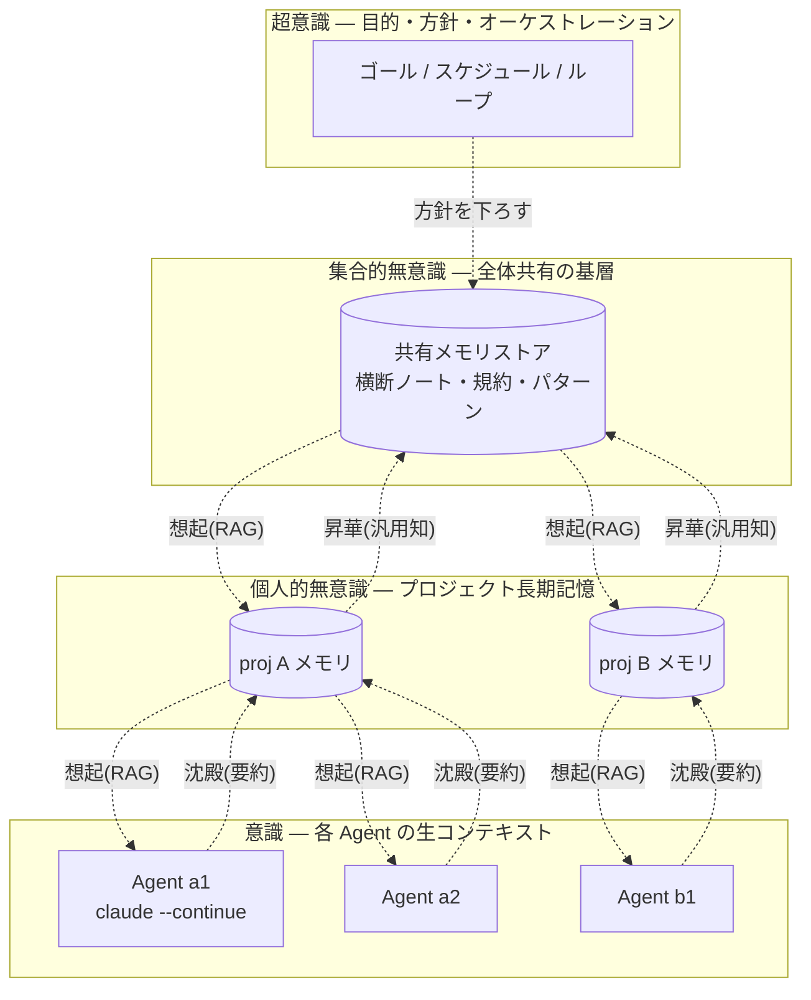

# 四層記憶アーキテクチャ 設計書 — 意識 / 個人的無意識 / 集合的無意識 / 超意識

作成: 2026-11-08 / ステータス: **提案（未着手）** / 別トラック（vim調査・ブラウザ刷新とは独立）

## 1. 背景・目的

多エージェント並列 ADE（Agent Development Environment）で最も価値が高いのは、
各エージェントの**コンテキスト保持＝長期記憶化**である。現状このアプリの「記憶」は
ばらばらに存在する：

- `CLAUDE.md`（プロジェクトの明示知識）
- `aidt-workspace` / `aidt-projects`（レイアウト・プロジェクトのブックマーク）
- 各 Agent の `claude --continue`（cwd ごとの直近会話）
- worktree のブランチ群

これらを**ひとつの記憶モデル**に統合し、「忘れる／思い出す／沈殿する」を設計として
扱えるようにする。枠組みとしてユング的な**4つの意識層**を採用する：

| 層 | 意味 | スコープ | 寿命 |
|---|---|---|---|
| **意識 (conscious)** | 今まさに注意している文脈 | 今のターン/セッション | 揮発（`/compact` で圧縮・破棄） |
| **個人的無意識 (personal)** | この人/プロジェクトが思い出せる記憶 | プロジェクト単位 | 永続 |
| **集合的無意識 (collective)** | 全プロジェクト/全Agentが共有する基層 | グローバル | 永続 |
| **超意識 (super)** | 目的・先見・オーケストレーション | メタ（全体の方針） | 永続 |

**非ゴール**：Agent 間の自律コマンド注入は作らない（§7 のガードレール参照）。
集合的無意識は「**共有された読み取り可能な記憶**」であって「窓から窓への命令」ではない。

## 2. 全体像



**2方向の流れ**がこのモデルの肝：
- **下り（想起 / recall）**：上位層の記憶を、新しいターンの文脈に注入（RAG）。
- **上り（沈殿 / sediment・昇華 / sublimate）**：会話の要約を下位→上位へ押し上げる。

## 3. データモデル

単一の記憶基盤に `scope` を持たせて4層を表現する。実装は軽量に
**SQLite（+ 任意で埋め込み）** を想定（Rust 側 `rusqlite`、`~/.aidt/memory.db`）。

```sql
CREATE TABLE memory (
  id          TEXT PRIMARY KEY,         -- uuid
  scope       TEXT NOT NULL,            -- 'conscious' | 'personal' | 'collective' | 'super'
  project_id  TEXT,                     -- personal で必須、collective/super は NULL
  agent_id    TEXT,                     -- conscious のみ
  kind        TEXT NOT NULL,            -- 'summary' | 'decision' | 'convention' | 'goal' | 'note'
  title       TEXT NOT NULL,
  body        TEXT NOT NULL,
  tags        TEXT,                     -- JSON 配列
  embedding   BLOB,                     -- 任意：類似検索用ベクタ
  salience    REAL NOT NULL DEFAULT 0,  -- 重要度（想起の優先度 / 昇華の閾値）
  created_at  INTEGER NOT NULL,
  updated_at  INTEGER NOT NULL,
  expires_at  INTEGER                   -- conscious のみ（揮発）。NULL = 永続
);
CREATE INDEX idx_memory_scope   ON memory(scope);
CREATE INDEX idx_memory_project ON memory(project_id);
```

- **conscious**：`expires_at` を持ち、`/compact` 相当で圧縮・期限切れ削除。
- **personal**：`project_id` 単位。CLAUDE.md・決定事項・プロジェクト規約の沈殿先。
- **collective**：`project_id = NULL`。全体で共有する規約・パターン・再利用知。
- **super**：現在のゴール・方針・スケジュール。数は少なく、常時プロンプト先頭に。

## 4. 遷移ルール（沈殿 / 昇華）

| 遷移 | 契機 | 既定動作 |
|---|---|---|
| 意識 → 個人的無意識（沈殿） | セッション終了 / `/compact` / 手動 | 会話を要約し `kind=summary` で personal に保存 |
| 個人的 → 集合的（昇華） | `salience` が閾値超 / 手動タグ「shared」 | プロジェクト固有語を外した**汎用知**を collective へ複製 |
| 超意識 → 下層（方針伝播） | ゴール変更時 | 現ゴールを全 Agent のプロンプト先頭に注入 |
| 任意 → 想起（recall） | 新ターン開始時 | scope 別に関連記憶を取得しプロンプトに注入 |

**原則**：昇華（個人的→集合的）は**自動では危険**（固有情報の漏れ）。既定は
「閾値で**候補を提示**→人間が承認」。完全自動化はしない。

## 5. 想起（recall）の優先順位

新ターンのプロンプトに注入する順（上ほど先頭・高優先）：

1. **超意識**：現在のゴール・方針（常時・少量）
2. **意識**：直近の自分の要約（`/compact` 後の圧縮文脈）
3. **個人的無意識**：同 `project_id` の高 `salience` 記憶を上位 N 件
4. **集合的無意識**：クエリ（今の作業内容）に近い共有知を上位 M 件

埋め込みが無い初期実装では「`salience` + タグ一致 + 新しさ」で近似してよい。

## 6. 既存モジュールへの接続点

| 層 | 既存の受け皿 | 追加するもの |
|---|---|---|
| 意識 | 各 Agent の端末 / `claude --continue`（`src/app.ts:300`） | セッション要約の取り込み |
| 個人的無意識 | `persistence.ts`（`aidt-workspace`）/ `CLAUDE.md` | `project_id` 単位のメモリ読み書き |
| 集合的無意識 | **macro スパイラル表示**（全プロジェクト俯瞰, `render.ts`） | 共有メモリストア + 横断検索UI |
| 超意識 | （新設）上位オーケストレータ | ゴール/スケジュール状態 |

- Rust 側に `src-tauri/src/memory.rs`（SQLite CRUD + 検索）を新設し、
  `read_memory` / `write_memory` / `query_memory` コマンドを公開。
- フロント側 `src/memory.ts`（ブリッジ）＋各層のビュー。
- **macro ビュー**は「集合的無意識の可視化」として最適：プロジェクトを金角螺旋に
  並べる既存 UI に、共有記憶ノードを重ねる。

## 7. 設計ガードレール（CLAUDE.md 由来・厳守）

- **Agent 間の自律コマンド注入は作らない**。集合的無意識は**読み取り共有**＋
  **サブエージェント（Task ツール）**で実現する。横断は「記憶を共有して各自が参照」。
- 人間主導の手動クロス送信（`Alt+Enter` 送信バー）は維持。
- 昇華（固有情報を全体へ上げる）は**既定で人間承認**を挟む。
- `write_guardrails` 同様、ユーザー著作物を勝手に上書きしない。

## 8. Claude Code 全機能との対応（15コマンド）

| 区分 | コマンド | 対応層 |
|---|---|---|
| BUILD | `/goal` | 超意識 |
| | `/batch` `/subtask` | 集合的（共有文脈のファンアウト） |
| | `/deep-research` | 超意識（先見的調査） |
| | `/design` | 意識（今の制作物） |
| CONTEXT | `/plan` | 意識 |
| | `/memory` | 個人的無意識 |
| | `/compact` | 意識の圧縮→沈殿の契機 |
| | `/branch` `/rewind` | 個人的無意識（分岐・巻き戻し） |
| CONTINUE | `/mcp` | 集合的（共有ツール知識） |
| | `/loop` `/schedule` `/remote-control` | 超意識（自律・遠隔） |
| | `/simplify` | 横断（コード衛生） |

## 9. 実装フェーズ（提案）

1. **フェーズ1：個人的無意識（まずここ）** — `memory.rs` + SQLite、`project_id`
   単位の読み書き、セッション要約の沈殿、新ターンでの想起注入。最小で効果大。
2. **フェーズ2：意識の圧縮** — `/compact` 連携、`expires_at` による揮発管理。
3. **フェーズ3：集合的無意識** — 共有ストア＋ macro ビューへの可視化、昇華の
   人間承認フロー。
4. **フェーズ4：超意識** — ゴール/スケジュール状態、方針の全 Agent 伝播、
   `/loop` `/schedule` 連携。

## 10. 未決事項

- 埋め込みモデルをどうするか（ローカル軽量 vs API）。初期は無しでも成立。
- 沈殿の自動要約を誰が行うか（各 Agent の claude に要約させる vs 専用サブエージェント）。
- `salience` の算出式（アクセス頻度・手動ピン・新しさの重み）。
- 集合的無意識の**粒度**（規約・スニペット・意思決定ログのどれを共有するか）。

---

**次の一歩**：フェーズ1（個人的無意識＝プロジェクト長期記憶）から着手するのが
費用対効果が最も高い。`memory.rs` のスキーマ確定 → 沈殿（要約保存）→ 想起（注入）
の最小ループを作り、1プロジェクトで体感する。
